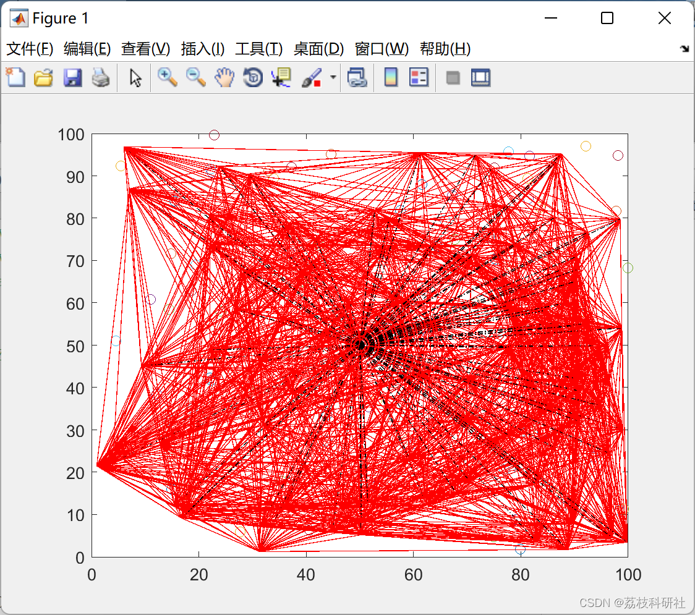
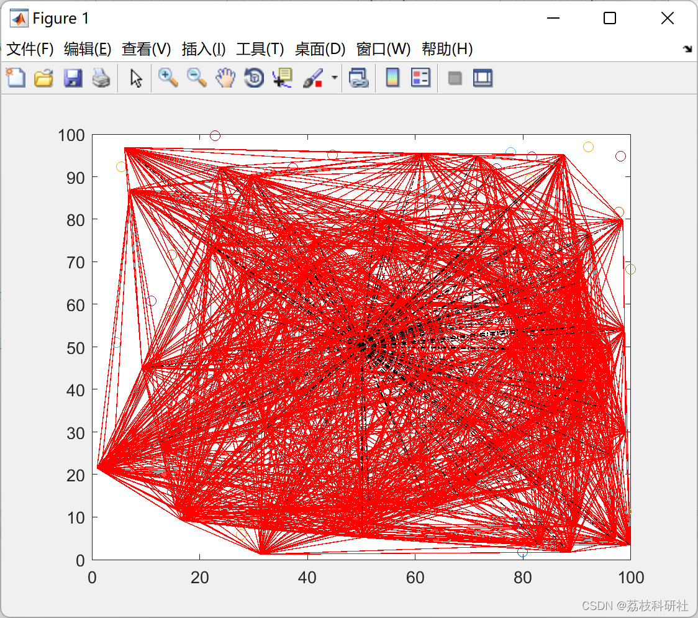

# [Wireless Sensors]Energy-efficient Sleep-Wake Awareness (EESAA) Intelligent Routing for WSN (Matlab Code Implementation)

🏆 Bloggers' Advantage: 🌞🌞🌞 The content of the blog is as thorough and logical as possible to facilitate readers.
⛳️ Mantra: A journey of a thousand miles begins with a single step.
📋📋📋 Table of Contents: 🎁🎁🎁 1. Overview📚 2. Running Results🎉 3. References🌈 4. MATLAB Code Implementation
​Edit💥 1. Overview Wireless Sensor Networks (WSN) are increasingly applied in environments beyond human reach, and have been greatly resolved recently. To optimize network operations, many routing algorithms have been proposed, mainly focusing on energy efficiency, network lifespan, and clustering processes. Considering the homogeneity of the network, an Energy-Efficient Sleep-Wake Perception (EESAA) Smart Routing Protocol for WSN was proposed. In our proposed technology, we evaluated and enhanced certain issues, such as network stability, network lifespan, and cluster head selection process. Using the concept of feature pairing between sensor nodes, the energy utilization was optimized. Simulation results indicate that the proposed protocol significantly improves network parameters and can be a useful method for WSN.
Partial code:
clear all;
%%% INITIALIZATION %%
xm=100;
ym=100;
range=10;
sink.x=50;
sink.y=50;
n = 100;       %%%number of nodes%%%
p=0.1;
Eo=0.5;       %%%initial energy of network%%%%
ETX=50*0.000000001;
ERX=50*0.000000001;
Efs=10*0.000000000001;
Emp=0.0013*0.000000000001;
%Data Aggregation Energy
EDA=5*0.000000001;
a=1;  
rmax=3000;      %%%number of rounds%%%  
cluster_range=20;  
do=sqrt(Efs/Emp);  
figure(1);  
for i=1:1:n  
S(i).xd=rand(1,1)*xm;  
XR(i)=S(i).xd;  
S(i).yd=rand(1,1)*ym;  
YR(i)=S(i).yd;  
S(i).G=0;  
%%%S(i).E=Eo*(1+rand*a); %%% hetrogenous energy for normal nodes with different staritng nodes %%%%  
S(i).E=Eo    %%% for homogenous energy distribution %%%  
%%%initially there are no cluster heads only nodes%%%  
S(i).type='N';  %%% defines type of node %%%%  
S(i).neighbour_flag=0;  
S(i).checked=0;  
S(i).id=i;  
S(i).CH_FLAG=1;  
% plot(S(i).xd,S(i).yd,'o','LineWidth',2, 'MarkerEdgeColor','b','MarkerFaceColor',[1 0.4 .3],'MarkerSize',10)  
%  grid on;  
%  hold on;  
end  
S(n+1).xd=sink.x;  %%% BTS x coordinate%%%  
S(n+1).yd=sink.y;  %%% BTS y cooordinate%%%  
% plot(S(n+1).xd,S(n+1).yd,'h','LineWidth',2, 'MarkerEdgeColor','b','MarkerFaceColor','g','MarkerSize',12)  
countCHs=0;  
cluster=1;  
flag_first_dead=0;  
flag_teenth_dead=0;  
flag_all_dead=0;  
dead=0;  
first_dead=0;  
teenth_dead=0;  
all_dead=0;  
allive=n;  
%%%counter for bit transmitted to Bases Station and to  
%%%Cluster Heads %%%  
packets_TO_BS=0;  
packets_TO_CH=0;  
temp_neighbour_distance=0;  
x=1;  
y=1;  
figure(1);  
%%% FORMATION OF PAIRS AMOUNG NODES %%%  
for i=1:1:n  
neig_distance=Inf;  
if(S(i).E>0 && S(i).neighbour_flag==0)  
ID=0;  
for h=1:1:n  
if(S(h).E>0 && S(h).neighbour_flag==0)  
if(h~=i)  
temp_neighbour_distance= sqrt( (S(i).xd-(S(h).xd) )^2 + (S(i).yd-(S(h).yd) )^2 );  
if(temp_neighbour_distance<=range)  
if(temp_neighbour_distance<neig_distance)  
neig_distance=temp_neighbour_distance;  
ID=h;  
end  
end  
end  
end  
end  
if (ID>0)  
S(i).neighbour=ID;  
S(i).mode='A';  
S(i).neighbour_flag=1;  
S(ID).neighbour_flag=1;  
S(ID).neighbour=i;  
S(ID).mode='S';  
P.pair(x)=ID;  
P.axis(x)=S(i).xd;  
x=x+1;  
%                hold on;  
else  
S(i).neighbour=ID;  
S(i).mode='A';  
up.unpairs(y)=i;  
y=y+1;  
%          plot(S(i).xd,S(i).yd,'o','LineWidth',2, 'MarkerEdgeColor','k','MarkerFaceColor',[1 0.4 .3],'MarkerSize',10)  
end  
end  
end  
hold on;  
for i=1:1:n  
for j=1:1:n  
distance(i,j)=((S(i).xd-(S(j).xd))^2 + (S(i).yd-(S(j).yd) )^2 )^(1\2);  
end  
end  
figure(1);  
for r=0:1:rmax  
r  
alive=n;  
dead=0;  
figure(1);  
for i=1:1:n  
if (S(i).E<=0)  
plot(S(i).xd,S(i).yd,'^','LineWidth',2, 'MarkerEdgeColor','r','MarkerFaceColor','r','MarkerSize',10)  
dead=dead+1;  
if (dead==1)  
if(flag_first_dead==0)  
first_dead=r  
flag_first_dead=1;  
🎉3 References
🌈4 Matlab code implementation

## Images

<!-- PAYMENT_BLOCK -->

## Get this dataset

- Payment link (Stripe): [Buy now](https://buy.stripe.com/3cs8yP7sY87d0vu9AB)
- Payment QR code: 

<!-- /PAYMENT_BLOCK -->
